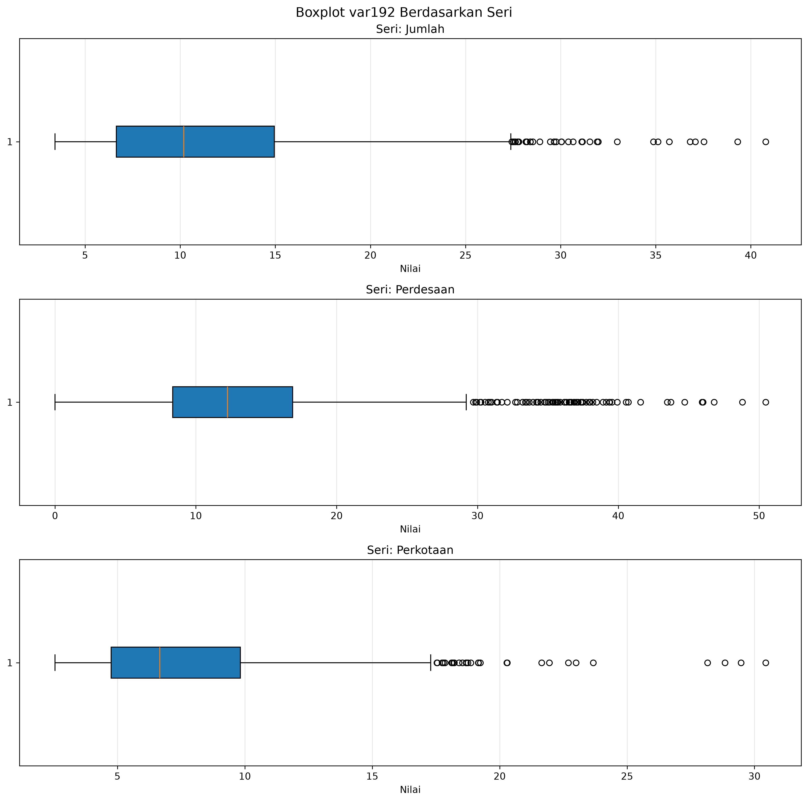
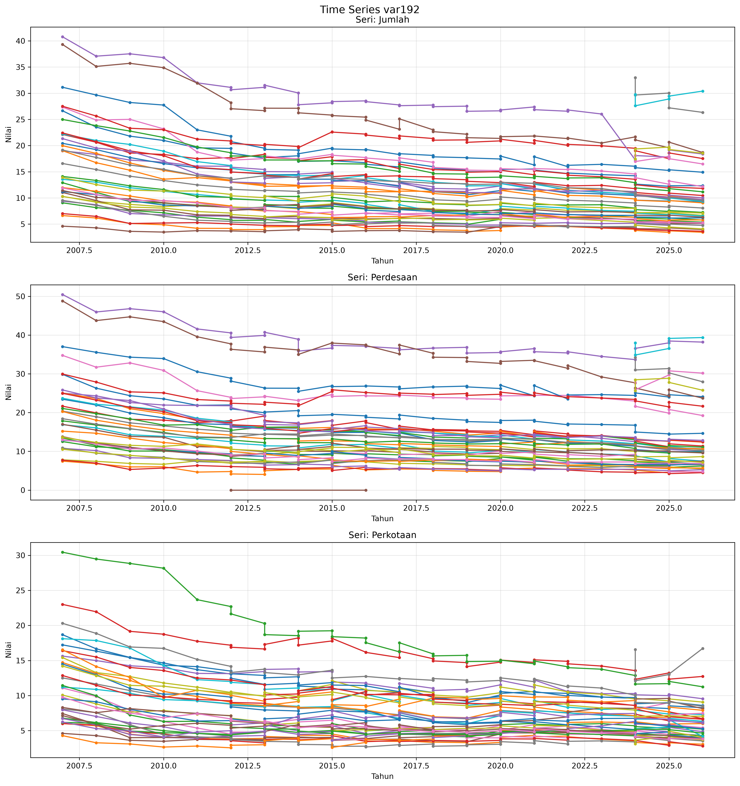
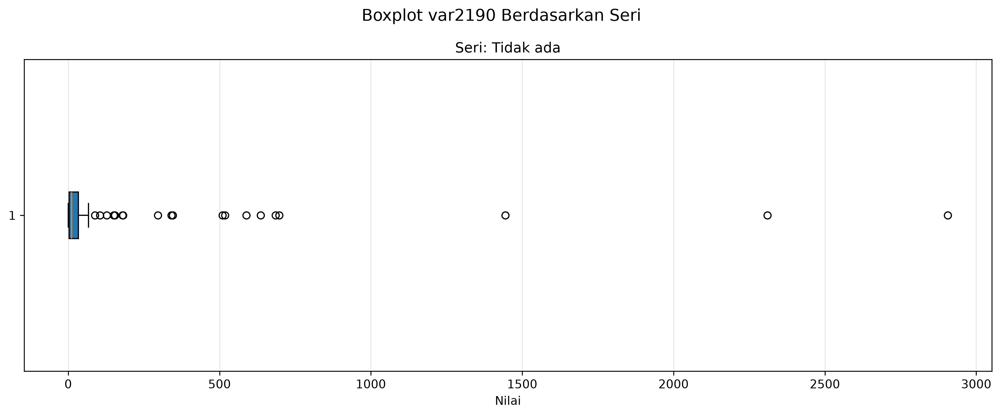
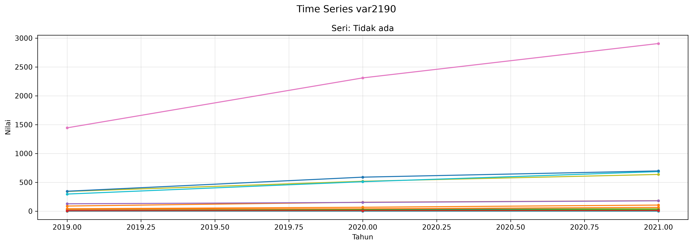
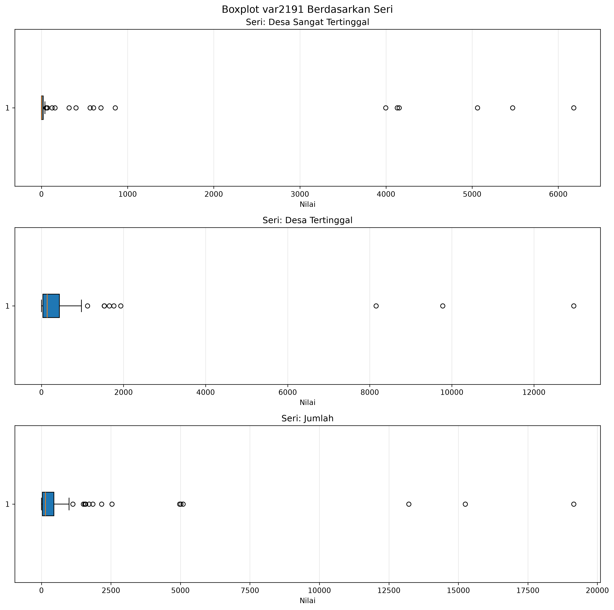
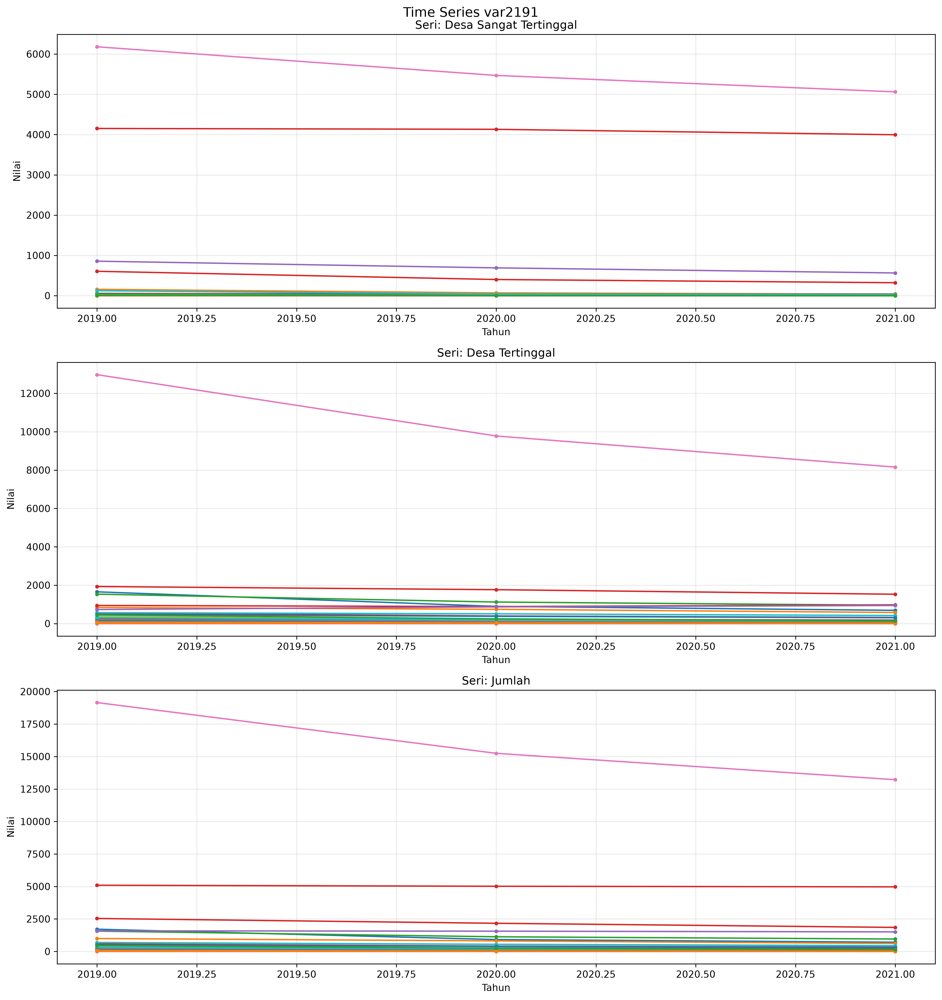

# Laporan Tahap 2 - Sprint 1

## 1. Tujuan Analisis

Analisis dilakukan terhadap var192, var2190, dan var2191 untuk mengetahui karakteristik statistik setiap seri dan wilayah.

## 2. Statistik Deskriptif

- `profil_per_seri.csv`
- `profil_per_provinsi.csv`

## 3. Visualisasi

### var192

### var2190

### var2191

## 4. Deteksi Calon Anomali

Deteksi dilakukan menggunakan metode IQR dengan batas 1,5 kali IQR pada setiap kombinasi variabel, seri, dan wilayah. Hasilnya hanya merupakan calon anomali, bukan bukti kesalahan data.

Daftar hasil tersedia pada `calon_anomali.csv` dan ringkasannya pada `ringkasan_anomali.csv`.

Tidak dilakukan penghapusan, penggantian, atau perbaikan terhadap data asli.
